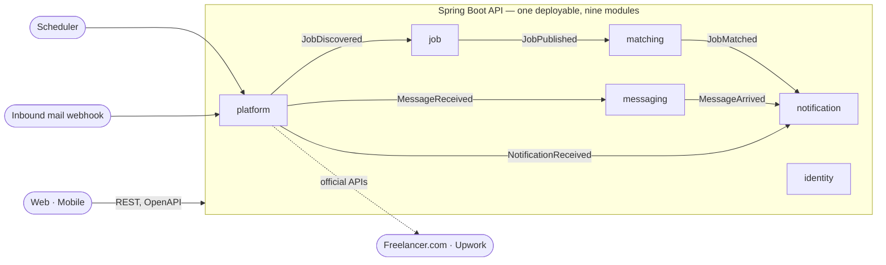

# Freelance Command Center

One inbox for freelancers who work on several platforms. New jobs, messages and platform notifications from
Freelancer.com, Upwork, Fiverr, Bionluk and Arc.dev arrive in one place, on the web and on the phone, with push
notifications. AI job scoring and proposal drafts come next.

A Java 25 / Spring Boot 4 **modular monolith** with **hexagonal** modules and **domain-driven design**, React and
React Native clients on a generated, typed API contract, and a containerized production stack behind Cloudflare.

> Status: running in production. Accounts, the job feed, job alerts, the message inbox and the notification feed
> work end to end; the Upwork and Freelancer.com account connections await the platforms' API approval.

## Features

| Feature | Status |
|---|---|
| **Accounts:** sign-up with e-mail verification, sign-in on web and mobile, password reset | done |
| **Unified job feed:** Freelancer.com and Upwork through their official APIs; Arc.dev and Bionluk through their notification e-mails, forwarded to the workspace's inbox address | in progress (API feeds and the inbox address work; parsers for the Arc.dev and Bionluk e-mails are next) |
| **Job alerts:** keyword filters per workspace, push notifications for matching jobs | done (Android) |
| **Unified messages:** conversations from every platform in one list, with unread state and push notifications; replies are written on the platform | in progress (from forwarded e-mails; Freelancer.com and Upwork connections await API approval) |
| **Bid and platform notifications:** decisions on your proposals and platform notices in one feed | in progress (platform notices from forwarded e-mails; proposal decisions await API approval) |
| **AI fit score** for every job, based on the profile imported from your platform accounts, with the reasons behind the score | planned |
| **Proposal drafts** in the job's language, with a suggested price; you review and approve before anything is sent | planned |
| **Multi-language UI** (English, Turkish), on the web and on mobile | done |

## Architecture



Modules talk only through published APIs and domain events; every arrow inside the API is an event delivered through
a transactional outbox. The full design is in [docs/architecture.md](docs/architecture.md), the reasons behind it in
the [decision records](docs/adr).

### Modular monolith with Spring Modulith

- Each module is a **bounded context** (`identity`, `platform`, `job`, `matching`, `messaging`, `notification`, ...)
  that owns its PostgreSQL schema; no module reads another module's tables.
- Modules expose a small **published API** (`<module>/api`, Spring Modulith named interfaces) and communicate
  otherwise only through **domain events**.
- Events are stored by the Spring Modulith **event publication registry** in the same transaction as the change
  (transactional outbox) and handled by `@ApplicationModuleListener`s after commit; incomplete publications are
  republished on restart, and every handler is **idempotent**.
- `ApplicationModules.verify()` fails the build on any boundary violation, and the tests generate the module
  documentation.

### Hexagonal architecture and DDD inside each module

- `domain` (plain Java: no Spring, no JPA) → `application` (one use case class per use case, outbound ports, events)
  → `adapter.in` (REST controllers, schedulers) and `adapter.out` (JPA, Redis, platform clients, SMTP, push).
  **ArchUnit** tests enforce the direction of every dependency.
- **Aggregates** guard their invariants and change only through their methods (`User`, `Conversation`,
  `JobFilter`, `PlatformConnection`); one aggregate per transaction, others react to its events.
- **Value objects** and **typed IDs** as immutable records (`Email`, `Keyword`, `JobBudget`, `JobId`,
  `WorkspaceId`); IDs are time-ordered **UUIDv7** generated by the application.
- JPA entities live in the persistence adapters and are mapped to and from the domain model.

### Design patterns

| Pattern | Where |
|---|---|
| Ports and adapters | Every module: use cases depend on `port.out` interfaces, adapters implement them |
| Strategy + registry | One adapter per platform; `PlatformRegistry` selects it by platform and answers which capabilities it has |
| Interface segregation (capability ports) | `JobSource`, `MessageSource`, `NotificationSource`, `ProposalStatusTracker`, `AccountConnector`: a platform implements only what it supports |
| Anti-corruption layer | A translator per platform maps API payloads to the canonical model; the raw payload is kept as JSONB so mappings can be re-applied |
| Chain of parsers | `PlatformMailParser`s per platform; the first that understands a forwarded e-mail reads it, unknown mails become notices |
| Transactional outbox + idempotent consumer | Spring Modulith event publication registry; handlers de-duplicate by natural keys |
| Interceptor | Upwork requests renew OAuth access tokens and retry once after a 401 |
| High-watermark sync | Job sync reads only listings updated since the last run, in bounded pages |
| Keyset pagination | Every list endpoint: opaque cursors over keyset positions, not offsets |

### Java 25 and Spring Boot 4 in use

- **Java:** records for value objects, typed IDs, events, DTOs and configuration; virtual threads for request
  handling; text blocks for SQL; pattern matching and switch expressions; sequenced collections.
- **Spring Web MVC** with RFC 9457 **Problem Details** (stable error codes, translated by the clients) and Bean
  Validation; **springdoc** generates the OpenAPI contract, which is committed and checked in CI.
- **RestClient** for the Freelancer.com REST and Upwork GraphQL APIs, the OAuth 2 token endpoints and the Expo Push
  Service.
- **Spring Security:** two filter chains (users with JWT bearer tokens, the mail webhook with a service secret);
  OAuth 2 resource server for self-issued **RS256 JWTs**; Argon2id password hashing.
- **Spring Data JPA** for aggregates and **JdbcClient** for queries; **Flyway** migrations; `SELECT ... FOR UPDATE`
  where ordering matters.
- **Spring Data Redis** for sign-in attempt limits and per-IP rate limiting.
- **Typed `@ConfigurationProperties`** (records), `SchedulingConfigurer` fixed-delay tasks, `MessageSource` for
  localized e-mails, Actuator health probes.
- **Developer experience:** Docker Compose support starts PostgreSQL, Redis and Mailpit on `spring-boot:run`;
  `spring-boot:test-run` uses Testcontainers instead.

### Security

- Short-lived access tokens; opaque refresh tokens stored as hashes, rotated on every use, with reuse detection that
  revokes the whole token family.
- On the web the refresh token lives only in an `HttpOnly`, `SameSite=Strict` cookie; on mobile in the secure store.
- Platform OAuth tokens are encrypted at rest with AES-256-GCM.
- Responses never reveal whether an e-mail address is registered; sign-in, reset and resend requests are rate limited.

### Testing and quality

- JUnit 5 and AssertJ unit tests for domain and application code; end-to-end HTTP integration tests on
  **Testcontainers** (PostgreSQL, Redis, Mailpit) with one shared context.
- Architecture tests: Spring Modulith verification and ArchUnit layering rules.
- Contract tests: the OpenAPI document must match the committed spec; every API error code must be translated in
  every client language.
- The compiler runs with `-Xlint:all` and fails on warnings; Spotless (Palantir Java Format) and Prettier keep the
  formatting; JaCoCo reports coverage.
- Clients: Vitest and Testing Library (web), Jest with React Native Testing Library (mobile), oxlint / ESLint and
  strict TypeScript.

### Infrastructure and delivery

- **Container images:** the API as a layered Spring Boot jar on a JRE, running as a non-root user; the web app on
  nginx, which also proxies the API so both share one origin.
- **Production:** one arm64 host on Hetzner Cloud running Docker Compose (API, web, PostgreSQL, Redis, daily
  backups). **Cloudflare Tunnel** is the only way in: the host publishes no ports.
- **Inbound mail:** Cloudflare Email Routing hands forwarded platform e-mails to an **Email Worker** (TypeScript),
  which posts the raw message to the API's webhook.
- **Outbound mail** through an SMTP relay with SPF, DKIM and DMARC.
- **Delivery:** GitHub Actions builds and tests the API and the clients and builds both images on every pull request;
  a release is a `git push` to the host, whose hook rebuilds and restarts the changed services.
- **Operations:** health endpoint watched by an external uptime monitor; Dependabot keeps dependencies current.

## Tech stack

| Part | Technology |
|---|---|
| Backend | Java 25, Spring Boot 4, Spring Modulith, Spring Security, Spring Data JPA, Hibernate, Flyway |
| Data | PostgreSQL 18 (one schema per module, JSONB), Redis 8 |
| AI (planned) | Claude via the official Anthropic Java SDK, behind a port |
| Web | React 19, TypeScript, Vite, TanStack Router and Query, Tailwind CSS, i18next |
| Mobile | Expo (React Native), Expo Router, Expo Notifications (FCM), expo-secure-store |
| Shared client code | Typed API client generated from the OpenAPI spec (openapi-typescript, openapi-fetch), shared translations |
| Build and quality | Maven, npm workspaces, JUnit 5, Testcontainers, ArchUnit, JaCoCo, Spotless, Vitest, Jest |
| Infrastructure | Docker, Docker Compose, nginx, Cloudflare (Tunnel, Email Routing, Workers), Hetzner Cloud, GitHub Actions |

## Repository layout

```
apps/api        Spring Boot backend (modular monolith)
apps/web        React web client
apps/mobile     Expo mobile client
packages/       Typed API client and shared translations
infra/          Docker Compose files, deploy hook, Cloudflare Email Worker
docs/           Architecture, decision records, local setup
```

## Getting started

Requirements: JDK 25, Node 22+, Docker.

```bash
npm install                           # TypeScript workspaces (web, mobile, shared packages)
cd apps/api && ./mvnw verify          # backend build and tests
cd apps/api && ./mvnw spring-boot:run # API on http://localhost:8080 (starts PostgreSQL, Redis and Mailpit via Docker Compose)
npm run web:dev                       # web app on http://localhost:5173; e-mails arrive in Mailpit, http://localhost:8025
npm run mobile:start                  # mobile app; press s to switch between the development build and Expo Go
```

Platform credentials, account connections, push notifications on a phone and forwarded e-mails are set up as
described in [docs/setup.md](docs/setup.md).

## Documentation

- [Architecture](docs/architecture.md): system context, modules, flows, data ownership, API conventions, deployment.
- [Decision records](docs/adr): why the modular monolith, the module boundaries, the authentication design, the API
  contract, the e-mail based integration and the single-host deployment were chosen.
- [Local setup](docs/setup.md): platform credentials, push notifications, forwarded e-mails.
- [CLAUDE.md](CLAUDE.md): repository conventions and the full command list.

## License

[MIT](LICENSE)
