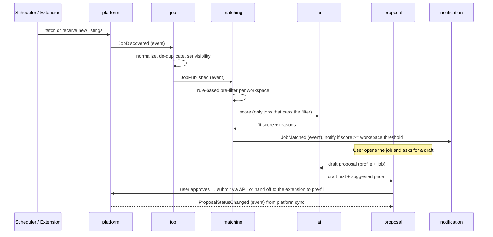

# Architecture

The system design as currently agreed. Implementation status is tracked in the [README](../README.md#features).

## Goals

- One place to discover, evaluate and respond to freelance jobs across several platforms.
- AI assistance (job-to-profile scoring, proposal drafting, price suggestions) with predictable cost.
- Web, mobile and browser-extension clients on top of one backend.
- A codebase that demonstrates production-grade practices: clear module boundaries, tests, CI, documentation.

## System context

## Platform integration strategy

| Platform | Integration | Notes |
|---|---|---|
| Freelancer.com | Official REST API (OAuth 2) | Server-side polling of new projects, bid submission through the API. |
| Upwork | Official GraphQL API (OAuth 2) | Requires an approved API key. |
| Fiverr, Bionluk, Arc.dev | Browser extension | Reads pages the user opens/allows inside their own session and sends structured data to the API. Never submits on its own: it pre-fills forms and the user clicks submit. |

Patterns in the `platform` module (reasons in [ADR 0010](adr/0010-architecture-style-and-platform-patterns.md)):

- **Capability ports (interface segregation):** `JobSource`, `ProposalSubmitter`, `ProposalStatusTracker`,
  `AccountConnector`. Each platform adapter implements only the capabilities the platform supports.
- **Strategy + registry:** every adapter is a strategy for its ports; `PlatformRegistry` selects it by
  `PlatformCode` and answers which capabilities a platform has. Adding a platform means adding an adapter.
- **Anti-corruption layer:** a translator per platform maps platform data to the canonical `JobListing` model. The raw
  payload is kept (JSONB) so mappings can be fixed and re-applied.
- **Decorators** around adapters for rate limiting (Redis token bucket), retries, circuit breaking and OAuth token
  refresh, so adapters contain only platform logic.
- **Factory** for API clients configured with one connection's credentials.
- **Inbound port** `IngestCapturedJobs` for data pushed by the browser extension; it enters the same canonical model,
  so the rest of the system does not know whether a job came from an API or from the extension.

## Backend modules

| Module | Responsibility |
|---|---|
| `identity` | Users, workspaces, authentication (JWT access + refresh tokens), devices. |
| `profile` | The freelancer's professional profile: skills, experience, rates, languages — the single source of truth used for matching and proposals. |
| `platform` | Platform connections (OAuth tokens, extension pairing), per-platform adapters, sync scheduling. The only module that knows platform specifics. |
| `job` | The job catalog: normalized listings, de-duplication, visibility. Holds no per-user data. |
| `matching` | Per-workspace job filters, rule-based pre-filtering and fit scores; re-scores when the profile or filters change. |
| `proposal` | Proposal drafts, approval workflow, submission and outcome tracking (submitted → viewed → shortlisted → won / lost). |
| `ai` | Claude integration: scoring, drafting, pricing. Prompt templates, caching strategy, usage/cost tracking per workspace. |
| `notification` | Push (mobile), email and in-app notifications. |
| `shared` | Cross-cutting kernel: IDs (including `WorkspaceId`), money, time, error model. Kept deliberately small. |

Each module follows the hexagonal layout described in `CLAUDE.md` (`domain` / `application` / `adapter`).

The product ends at the proposal outcome: work on won projects (milestones, delivery, earnings) stays on the
platform.

## Data ownership

- Every user-owned record belongs to a **workspace** (`WorkspaceId`), not directly to a user. A user has exactly one
  workspace; the indirection lets agencies and teams be added without a schema migration.
- **Job visibility** depends on the source:
  - Jobs from official APIs are **public**: fetched once into a shared catalog and visible to every workspace.
  - Jobs captured by the browser extension are **private** to the workspace that captured them; data read in one
    user's session is never shown to another user.
- Scores, filters, proposals and AI usage are always per workspace.

## Authentication

Owned by the `identity` module; details and reasons in [ADR 0008](adr/0008-authentication.md).

- Sign-up and sign-in with e-mail and password. Passwords are hashed with Argon2id. Responses never reveal whether an
  e-mail address is registered.
- Sign-up creates the user and their workspace. Unverified users can sign in; connecting platforms requires a
  verified e-mail address.
- **Access token:** RS256-signed JWT, valid for 15 minutes, carrying the user id and workspace id. Every module
  reads it through Spring Security's resource-server support.
- **Refresh token:** opaque random value, stored only as a SHA-256 hash, valid for 30 days, rotated on every use.
  Reusing an already rotated token revokes its whole token family (one family per signed-in device).
- **Web:** the refresh token lives in an `HttpOnly`, `Secure`, `SameSite=Strict` cookie limited to
  `/api/v1/auth`; the access token is kept in memory only. **Mobile:** both tokens are stored with
  `expo-secure-store`.
- E-mail verification and password reset use single-use, hashed, expiring tokens. A password reset revokes every
  refresh token of the user.
- Sign-in and token endpoints are rate-limited per IP address and e-mail address (Redis).
- Outgoing e-mail goes through a `MailSender` port; locally it is caught by Mailpit. Sign-in with Google (planned)
  attaches to the same user via the e-mail address.

## API conventions

Reasons in [ADR 0009](adr/0009-api-contract.md).

- **Contract:** code-first. springdoc generates the OpenAPI document from controllers and DTOs; it is committed as
  `packages/api-client/openapi.json` and CI fails when it differs from the code. Clients use types generated from
  it with `openapi-typescript` and call the API through `openapi-fetch` / `openapi-react-query`.
- **Paths:** `/api/v1/<plural-resource>`, kebab-case. Additive changes stay in `v1`; clients ignore unknown fields.
  A breaking change introduces `v2` for the affected resources.
- **Authentication:** `Authorization: Bearer <access token>` (see [Authentication](#authentication)).
- **IDs:** UUIDv7 generated by the application, exposed as strings. Domain code wraps them in typed IDs (`JobId`).
- **JSON:** camelCase properties; timestamps as ISO 8601 UTC (`2026-11-19T18:30:00Z`); dates as `2026-11-19`;
  money as `{"amount": "1250.00", "currency": "USD"}` with a decimal string and an ISO 4217 code.
- **Lists:** cursor pagination everywhere. Request `?limit=20&cursor=<opaque>` (default 20, maximum 100); response
  `{"items": [...], "nextCursor": "<opaque>" | null}`. Cursors are keyset positions, not offsets.
- **Errors:** RFC 9457 `application/problem+json` with a stable `code` (`<module>.<reason>`, for example
  `identity.email_already_registered`). Validation errors use `code: "validation.failed"` and an `errors` array
  of `{"field", "code"}` (`validation.not_blank`, ...). Clients translate `code`; `detail` is English text for
  developers and is never shown to users.
- **Idempotency:** endpoints with external side effects (submitting a proposal) accept an `Idempotency-Key` header.

## Core flow: from new job to proposal

## AI cost strategy

1. **Filter before calling the model.** Cheap deterministic rules (stack keywords, budget, client verification,
   competition) remove most listings before any AI call.
2. **Prompt caching.** The system prompt and the freelancer profile form a stable, cached prefix; only the job text
   varies.
3. **Batch API** for non-urgent bulk scoring (lower price, asynchronous).
4. **Model per task** is configuration, not code: each AI use case has its own model and effort setting.
5. **Usage tracking.** Every call stores token usage and cost so limits and reports are possible per user.

## Internationalization

- UI languages: English (default/fallback) and Turkish; more can be added by adding a locale folder.
- Shared translation resources in `packages/i18n`, used by web, mobile and extension.
- The API is language-neutral: it returns stable error codes; clients translate them. Server-generated text that
  reaches users (e.g. notification emails) uses Spring `MessageSource` with the user's preferred locale.
- AI-generated proposals are written in the language of the job post unless the user overrides it.

## Quality gates

- CI on every pull request: build, unit + integration tests, module boundary verification, lint, type-check.
- Code coverage reported (JaCoCo for the API; Vitest for clients, planned); no fixed vanity threshold, but new
  code is expected to be tested.
- Dependency updates through Dependabot.
