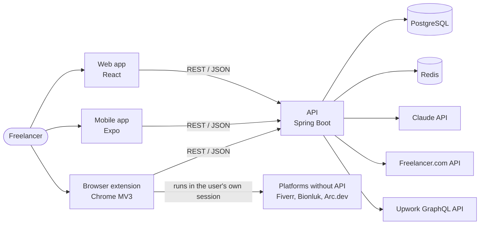
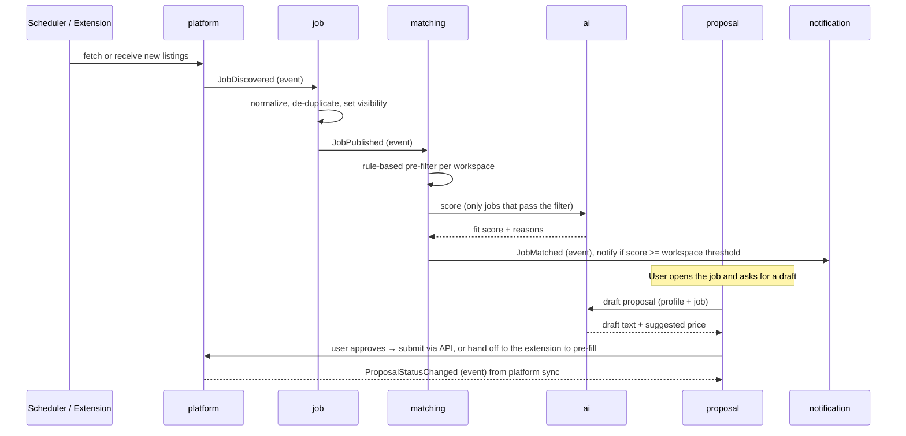

# Architecture

The system design as currently agreed. Implementation status is tracked in the [README](../README.md#features).

## Goals

- One inbox for freelance work across several platforms: new jobs, messages and platform notifications, with push
  notifications on the phone ([ADR 0011](adr/0011-product-focus-one-inbox.md)).
- AI assistance (job scoring, proposal drafting, price suggestions) with predictable cost (planned).
- Web, mobile and browser-extension clients on top of one backend.
- A codebase that demonstrates production-grade practices: clear module boundaries, tests, CI, documentation.

## System context

## Platform integration strategy

| Platform | Integration | Notes |
|---|---|---|
| Freelancer.com | Official REST API | Server-side job sync with one configured access token; messages and bid status through each user's OAuth 2 connection; bid submission through the API. |
| Upwork | Official GraphQL API (OAuth 2) | Server-side job sync with the server's own authorized API key; messages and proposal status through each user's OAuth 2 connection. Requires an approved API key. |
| Fiverr, Bionluk, Arc.dev | Browser extension | Reads pages the user opens/allows inside their own session and sends structured data to the API. Never submits on its own: it pre-fills forms and the user clicks submit. |

Patterns in the `platform` module (reasons in [ADR 0010](adr/0010-architecture-style-and-platform-patterns.md)):

- **Capability ports (interface segregation):** `JobSource`, `MessageSource`, `NotificationSource`,
  `ProposalSubmitter`, `ProposalStatusTracker`, `AccountConnector`. Each platform adapter implements only the capabilities the platform supports.
- **Strategy + registry:** every adapter is a strategy for its ports; `PlatformRegistry` selects it by
  `PlatformCode` and answers which capabilities a platform has. Adding a platform means adding an adapter.
- **Anti-corruption layer:** a translator per platform maps platform data to the canonical `JobListing` model. The raw
  payload is kept (JSONB) so mappings can be fixed and re-applied.
- **Decorators** around adapters for rate limiting (Redis token bucket), retries, circuit breaking and OAuth token
  refresh, so adapters contain only platform logic.
- **Factory** for API clients configured with one connection's credentials.
- **Inbound port** `IngestCapturedJobs` for data pushed by the browser extension; it enters the same canonical model,
  so the rest of the system does not know whether a job came from an API or from the extension.
- **Extension extractors:** the extension parses pages in the browser with one extractor (strategy) per site and sends
  a versioned JSON schema; page HTML never reaches the server. A site redesign is fixed by an extension release.

### Job sync

Platforms with a job API are polled by the `platform` module (`JobSyncUseCase`, every 5 minutes by default,
`fcc.platform.job-sync.*`):

- The jobs read this way are public and shared by all workspaces
  ([ADR 0007](adr/0007-module-boundaries-and-data-ownership.md)), so one credential per platform from the server
  configuration is enough. A platform without configured credentials is not registered.
  - Freelancer.com: a personal access token (`FREELANCER_ACCESS_TOKEN`).
  - Upwork: an API key and a refresh token from authorizing it once (`UPWORK_*`). Access tokens live 24 hours and
    are renewed with the refresh grant by a request interceptor, which also retries a request once after a 401. Upwork
    may rotate the refresh token, so the newest one is stored in `platform.oauth_refresh_tokens`.
- A per-platform **high-watermark** (the newest listing update seen) limits each run to listings updated since the
  last run, and a run reads a bounded number of pages to stay within the platform's rate limits. Freelancer.com lists
  by update time, oldest first, so a backlog is worked off over several runs without gaps. The Upwork search has no
  update-time filter: it is read newest first until the first known job, so a burst larger than one run is skipped.
  A failed run keeps the watermark, and the next run reads the same period again.
- Each run stores the raw payloads and one `JobDiscovered` event per listing in one transaction (outbox); the
  platform call itself happens outside the transaction.
- `job` turns each event into a catalog job, unique per platform listing. Only a newer platform update changes a
  job, so repeated events are harmless; a new job publishes `JobPublished`.

### New-job notifications

- Each workspace has one **job filter** (`matching`, `/api/v1/job-filter`): keywords and platforms. A job matches
  when it is on a chosen platform and its title, description or skills contain a keyword as a whole word or phrase,
  ignoring case. A filter without keywords matches nothing, so nobody is notified before choosing keywords.
- `matching` checks every `JobPublished` against the filters of its platform that have keywords and publishes
  `JobMatched` per matching workspace.
- `notification` pushes each match to the phones of the workspace (`/api/v1/devices`, one per Expo push token, with
  the app language for the texts) through the Expo Push Service, which forwards to FCM and APNs. The log
  `notification.job_notifications` makes repeated events harmless. Tokens the service reports as unregistered are
  removed; delivery receipts are not read. Push is best effort: a failed push is logged, not retried.

## Backend modules

| Module | Responsibility |
|---|---|
| `identity` | Users, workspaces, authentication (JWT access + refresh tokens). |
| `profile` | The freelancer's professional profile, imported read-only from the connected platform accounts; input of AI scoring and proposals (planned). |
| `platform` | Platform connections (OAuth tokens, extension pairing), per-platform adapters, sync scheduling. The only module that knows platform specifics. |
| `job` | The job catalog: normalized listings, de-duplication, visibility. Holds no per-user data. |
| `messaging` | Conversations and messages from the connected platforms, per workspace, with unread state. |
| `matching` | Per-workspace job filters, rule-based pre-filtering and fit scores; re-scores when the profile or filters change. |
| `proposal` | Proposal drafts, approval workflow, submission and outcome tracking (submitted → viewed → shortlisted → won / lost). |
| `ai` | Claude integration: scoring, drafting, pricing. Prompt templates, caching strategy, usage/cost tracking per workspace. |
| `notification` | The notification feed (new jobs, messages, bid status, platform notices), the phones registered for push, and delivery: push (mobile), e-mail and in-app. |
| `shared` | Cross-cutting kernel: IDs (including `WorkspaceId`), platform codes, money, pagination, error model, HTTP client settings. Kept deliberately small. |

Each module follows the hexagonal layout described in `CLAUDE.md` (`domain` / `application` / `adapter`).

The product ends at the proposal outcome: work on won projects (milestones, delivery, earnings) stays on the
platform.

## Data ownership

- Every user-owned record belongs to a **workspace** (`WorkspaceId`), not directly to a user. A user has exactly one
  workspace; the indirection lets agencies and teams be added without a schema migration.
- **Job visibility** depends on the source:
  - Jobs from official APIs are **public**: fetched once into a shared catalog and visible to every workspace.
  - Jobs captured by the browser extension are **private** to the workspace that captured them; data read in one
    user's session is never shown to another user.
- Messages, notifications, scores, filters, proposals and AI usage are always per workspace.

## Authentication

Owned by the `identity` module; details and reasons in [ADR 0008](adr/0008-authentication.md).

- Sign-up and sign-in with e-mail and password. Passwords are hashed with Argon2id. Responses never reveal whether an
  e-mail address is registered.
- Sign-up creates the user and their workspace. Unverified users can sign in; connecting platforms requires a
  verified e-mail address.
- **Access token:** RS256-signed JWT, valid for 15 minutes, carrying the user id (`sub`) and workspace id (`wid`).
  Every module reads it through Spring Security's resource-server support; controllers receive the caller as an
  `AuthenticatedUser`.
- **Refresh token:** opaque random value, stored only as a SHA-256 hash, valid for 30 days, rotated on every use.
  Reusing an already rotated token revokes its whole token family (one family per signed-in device).
- **Web:** requests from an allowed origin (`fcc.identity.web-origins`) get the refresh token as the `fcc_refresh`
  cookie (`HttpOnly`, `Secure`, `SameSite=Strict`, path `/api/v1/auth`), never in the body; the access token is kept
  in memory only. Other browser origins are rejected by CORS. **Mobile and extension:** requests without an `Origin`
  get the refresh token in the response body and send it back in the body; mobile stores both tokens with
  `expo-secure-store`.
- E-mail verification and password reset use single-use, hashed, expiring tokens; requesting a new link invalidates
  the earlier one. A password reset revokes every refresh token of the user.
- Attempt limits (Redis, answered with 429 `identity.too_many_attempts`): after 10 failed sign-ins within 15 minutes
  an e-mail address cannot sign in until the window ends; password reset requests are limited to 3 per address and
  hour, verification e-mail resends to 3 per user and hour. Unknown addresses are counted too, so a refusal reveals
  nothing. All `POST /api/v1/auth/**` requests are limited per client IP address
  (`fcc.identity.auth-requests-per-ip-per-minute`, default 20); behind a reverse proxy
  `server.forward-headers-strategy` must be set so the client address is used.
- Outgoing e-mail goes through the `IdentityMailer` port; locally it is caught by Mailpit. Sign-in with Google (planned)
  attaches to the same user via the e-mail address.

## API conventions

Reasons in [ADR 0009](adr/0009-api-contract.md).

- **Contract:** code-first. springdoc generates the OpenAPI document from controllers and DTOs; it is committed as
  `packages/api-client/openapi.json` and CI fails when it differs from the code. Clients use types generated from
  it with `openapi-typescript` and call the API through `openapi-fetch` / `openapi-react-query`.
- **Paths:** `/api/v1/<plural-resource>`, kebab-case. Additive changes stay in `v1`; clients ignore unknown fields.
  A breaking change introduces `v2` for the affected resources.
- **Authentication:** `Authorization: Bearer <access token>` (see [Authentication](#authentication)).
- **IDs:** UUIDv7 generated by the application, exposed as strings. Domain code wraps them in typed IDs (`JobId`).
- **JSON:** camelCase properties; timestamps as ISO 8601 UTC (`2026-11-19T18:30:00Z`); dates as `2026-11-19`;
  money as `{"amount": "1250.00", "currency": "USD"}` with a decimal string and an ISO 4217 code.
- **Lists:** cursor pagination everywhere. Request `?limit=20&cursor=<opaque>` (default 20, maximum 100); response
  `{"items": [...], "nextCursor": "<opaque>" | null}`. Cursors are keyset positions, not offsets.
- **Errors:** RFC 9457 `application/problem+json` with a stable `code` (`<module>.<reason>`, for example
  `identity.invalid_token`). Validation errors use `code: "validation.failed"` and an `errors` array
  of `{"field", "code"}` (`validation.not_blank`, ...). Clients translate `code`; `detail` is English text for
  developers and is never shown to users.
- **Idempotency:** endpoints with external side effects (submitting a proposal) accept an `Idempotency-Key` header.

## Core flow: from new job to proposal

## AI cost strategy

1. **Filter before calling the model.** Cheap deterministic rules (stack keywords, budget, client verification,
   competition) remove most listings before any AI call.
2. **Prompt caching.** The system prompt and the freelancer profile form a stable, cached prefix; only the job text
   varies.
3. **Batch API** for non-urgent bulk scoring (lower price, asynchronous).
4. **Model per task** is configuration, not code: each AI use case has its own model and effort setting.
5. **Usage tracking.** Every call stores token usage and cost so limits and reports are possible per user.

## Internationalization

- UI languages: English (default/fallback) and Turkish; more can be added by adding a locale folder.
- Shared translation resources in `packages/i18n`, used by web, mobile and extension.
- The API is language-neutral: it returns stable error codes; clients translate them. Server-generated text that
  reaches users (e.g. notification emails) uses Spring `MessageSource` with the user's preferred locale.
- AI-generated proposals are written in the language of the job post unless the user overrides it.

## Quality gates

- CI on every pull request: build, unit + integration tests, module boundary verification, lint, type-check.
- Code coverage reported (JaCoCo for the API; Vitest for clients, planned); no fixed vanity threshold, but new
  code is expected to be tested.
- Dependency updates through Dependabot.
