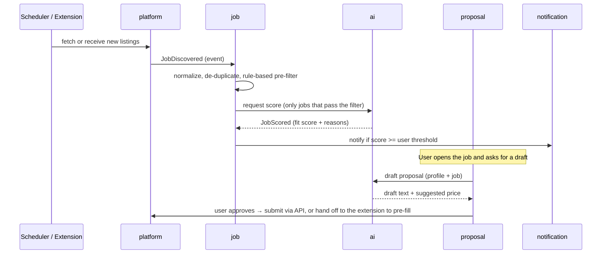

# Architecture

## Goals

- One place to discover, evaluate and respond to freelance jobs across several platforms.
- AI assistance (job-to-profile scoring, proposal drafting, price suggestions) with predictable cost.
- Web, mobile and browser-extension clients on top of one backend.
- A codebase that demonstrates production-grade practices: clear module boundaries, tests, CI, documentation.

## System context

## Platform integration strategy

| Platform | Integration | Notes |
|---|---|---|
| Freelancer.com | Official REST API (OAuth 2) | Server-side polling of new projects, bid submission through the API. |
| Upwork | Official GraphQL API (OAuth 2) | Requires an approved API key. |
| Fiverr, Bionluk, Arc.dev | Browser extension | Reads pages the user opens/allows inside their own session and sends structured data to the API. Never submits on its own: it pre-fills forms and the user clicks submit. |

All sources are adapters behind the same `PlatformJobSource` / `ProposalChannel` ports, so the rest of the system
does not know whether a job came from an API or from the extension.

## Backend modules

| Module | Responsibility |
|---|---|
| `identity` | Accounts, authentication (JWT access + refresh tokens), devices. |
| `profile` | The freelancer's professional profile: skills, experience, rates, languages — the single source of truth used for matching and proposals. |
| `platform` | Platform connections (OAuth tokens, extension pairing), per-platform adapters, sync scheduling. |
| `job` | Normalized job listings, de-duplication, rule-based pre-filtering, scoring results. |
| `proposal` | Proposal drafts, approval workflow, submission tracking and outcomes. |
| `ai` | Claude integration: scoring, drafting, pricing. Prompt templates, caching strategy, usage/cost tracking. |
| `notification` | Push (mobile), email and in-app notifications. |
| `shared` | Cross-cutting kernel: IDs, money, time, error model. Kept deliberately small. |

Each module follows the hexagonal layout described in `CLAUDE.md` (`domain` / `application` / `adapter`).

## Core flow: from new job to proposal

## AI cost strategy

1. **Filter before calling the model.** Cheap deterministic rules (stack keywords, budget, client verification,
   competition) remove most listings before any AI call.
2. **Prompt caching.** The system prompt and the freelancer profile form a stable, cached prefix; only the job text
   varies.
3. **Batch API** for non-urgent bulk scoring (lower price, asynchronous).
4. **Model per task** is configuration, not code: each AI use case has its own model and effort setting.
5. **Usage tracking.** Every call stores token usage and cost so limits and reports are possible per user.

## Internationalization

- UI languages: English (default/fallback) and Turkish; more can be added by adding a locale folder.
- Shared translation resources in `packages/i18n`, used by web, mobile and extension.
- The API is language-neutral: it returns stable error codes; clients translate them. Server-generated text that
  reaches users (e.g. notification emails) uses Spring `MessageSource` with the user's preferred locale.
- AI-generated proposals are written in the language of the job post unless the user overrides it.

## Quality gates

- CI on every pull request: build, unit + integration tests, module boundary verification, lint, type-check.
- Code coverage reported (JaCoCo / Vitest); no fixed vanity threshold, but new code is expected to be tested.
- Dependency updates through Dependabot.
