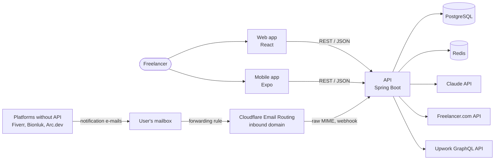
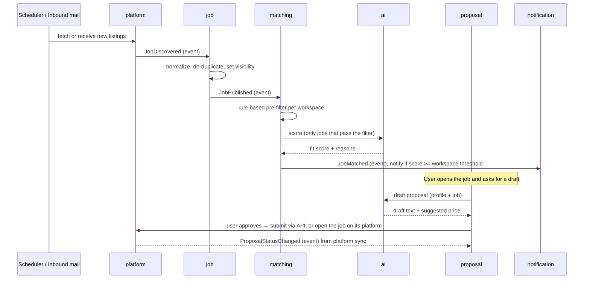
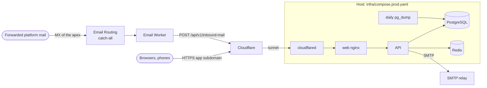

# Architecture

The system design as currently agreed. Implementation status is tracked in the [README](../README.md#features).

## Goals

- One inbox for freelance work across several platforms: new jobs, messages and platform notifications, with push
  notifications on the phone ([ADR 0011](adr/0011-product-focus-one-inbox.md)).
- AI assistance (job scoring, proposal drafting, price suggestions) with predictable cost (planned).
- Web and mobile clients on top of one backend.
- A codebase that demonstrates production-grade practices: clear module boundaries, tests, CI, documentation.

## System context

## Platform integration strategy

| Platform | Integration | Notes |
|---|---|---|
| Freelancer.com | Official REST API | Server-side job sync with one configured access token; messages and bid status through each user's OAuth 2 connection; bid submission through the API. |
| Upwork | Official GraphQL API (OAuth 2) | Server-side job sync with the server's own authorized API key; messages and proposal status through each user's OAuth 2 connection. Requires an approved API key. |
| Fiverr, Bionluk, Arc.dev | Forwarded notification e-mails ([ADR 0012](adr/0012-platforms-without-api-via-forwarded-notification-emails.md)) | Their terms forbid automated access, so the application never touches these sites. The user forwards the platform's notification e-mails to the workspace's inbox address; replies and proposals happen on the platform. The e-mails differ per platform: Arc.dev sends matching jobs; Fiverr, a seller marketplace without a job board, sends messages, orders and buyer briefs; Bionluk sends messages and notices, and only the buyer requests it e-mails reach the feed. |

Patterns in the `platform` module (reasons in [ADR 0010](adr/0010-architecture-style-and-platform-patterns.md)):

- **Capability ports (interface segregation):** `JobSource`, `MessageSource`, `NotificationSource`,
  `ProposalSubmitter`, `ProposalStatusTracker`, `AccountConnector`. Each platform adapter implements only the capabilities the platform supports.
- **Strategy + registry:** every adapter is a strategy for its ports; `PlatformRegistry` selects it by
  `PlatformCode` and answers which capabilities a platform has. Adding a platform means adding an adapter.
- **Anti-corruption layer:** a translator per platform maps platform data to the canonical `JobListing` model. The raw
  payload is kept (JSONB) so mappings can be fixed and re-applied.
- **Decorators** around adapters for rate limiting (Redis token bucket), retries, circuit breaking and OAuth token
  refresh, so adapters contain only platform logic.
- **Factory** for API clients configured with one connection's credentials.
- **Mail parsers:** a `PlatformMailParser` (strategy) reads one kind of notification e-mail of a platform into the
  same canonical model, so the rest of the system does not know whether a job came from an API or from an e-mail.
  `PlatformRegistry` holds any number of parsers per platform; the first one that understands a mail reads it. A mail
  no parser understands is shown as a notice. The parsers for Fiverr, Bionluk and Arc.dev mails are (planned).

### Job sync

Platforms with a job API are polled by the `platform` module (`JobSyncUseCase`, every 5 minutes by default,
`fcc.platform.job-sync.*`):

- The jobs read this way are public and shared by all workspaces
  ([ADR 0007](adr/0007-module-boundaries-and-data-ownership.md)), so one credential per platform from the server
  configuration is enough. A platform without configured credentials is not registered.
  - Freelancer.com: a personal access token (`FREELANCER_ACCESS_TOKEN`).
  - Upwork: an API key and a refresh token from authorizing it once (`UPWORK_*`). Access tokens live 24 hours and
    are renewed with the refresh grant by a request interceptor, which also retries a request once after a 401. Upwork
    may rotate the refresh token, so the newest one is stored in `platform.oauth_refresh_tokens`.
- A per-platform **high-watermark** (the newest listing update seen) limits each run to listings updated since the
  last run, and a run reads a bounded number of pages to stay within the platform's rate limits. Freelancer.com lists
  by update time, oldest first, so a backlog is worked off over several runs without gaps. The Upwork search has no
  update-time filter: it is read newest first until the first known job, so a burst larger than one run is skipped.
  A failed run keeps the watermark, and the next run reads the same period again.
- Each run stores the raw payloads and one `JobDiscovered` event per listing in one transaction (outbox); the
  platform call itself happens outside the transaction.
- `job` turns each event into a catalog job, unique per platform listing and owner. Only a newer platform update changes a
  job, so repeated events are harmless; a new job publishes `JobPublished`.

### Forwarded platform e-mails

- Each workspace has an inbox address (`/api/v1/mail-inbox`) whose local part is a random secret on the inbound
  domain (`INBOUND_MAIL_DOMAIN`); it can be replaced, and mail to a replaced address is dropped.
- A mail routing service (Cloudflare Email Routing with an Email Worker, see [Production](#production)) receives
  mail for the inbound domain and posts the raw MIME message to
  `POST /api/v1/inbound-mail` with the envelope recipient in `X-Envelope-To` and the shared secret
  (`INBOUND_MAIL_SECRET`) as bearer token. The webhook has its own security filter chain, because the caller is a
  service, not a user.
- The sender's domain names the platform. Every mail is stored once per Message-ID with its raw message
  (`platform.inbound_mails`) and listed for the workspace (`/api/v1/inbound-mails`) as `processed`,
  `unrecognized` (platform known, no parser understands the mail) or `unknown_sender`.
- The platform's mail parsers read the mail in the same transaction. Each job in it is published as a
  `JobDiscovered` event with the workspace as its owner, so it becomes a private job of that workspace and is matched
  only against its job filter; each message is published as a `MessageReceived` event and each notification as a
  `NotificationReceived` event for the workspace. An `unrecognized` mail is published as a notice: its subject, the
  start of its text and the platform's site ([ADR 0015](adr/0015-platform-notification-feed.md)). A redelivered mail
  publishes nothing. A parser that fails leaves the mail `unrecognized` instead of rejecting it, and the stored raw
  message can be read again.

### New-job notifications

- Each workspace has one **job filter** (`matching`, `/api/v1/job-filter`): keywords and platforms. A job matches
  when it is on a chosen platform and its title, description or skills contain a keyword as a whole word or phrase,
  ignoring case. A filter without keywords matches nothing, so nobody is notified before choosing keywords.
- `matching` checks every `JobPublished` against the filters of its platform that have keywords and publishes
  `JobMatched` per matching workspace.
- `notification` pushes each match to the phones of the workspace (`/api/v1/devices`, one per Expo push token, with
  the app language for the texts) through the Expo Push Service, which forwards to FCM and APNs. The log
  `notification.job_notifications` makes repeated events harmless. Tokens the service reports as unregistered are
  removed; delivery receipts are not read. Push is best effort: a failed push is logged, not retried.

### Platform account connections

Reasons in [ADR 0014](adr/0014-platform-account-connections.md).

- A workspace connects at most one account per platform with the OAuth 2 authorization code flow:
  `POST /api/v1/platform-connections/{platform}/authorizations` returns the consent page with a single-use `state`
  (15 minutes, bound to the workspace); the platform returns the user to the web client at
  `/connections/{platform}/callback` (`fcc.platform.connections.redirect-base-url`), which posts `code` and
  `state` to `POST /api/v1/platform-connections/{platform}`. `DELETE` on the same path deletes the tokens.
- Only platforms whose OAuth app is configured are connectable:
  - Freelancer.com: `FREELANCER_CLIENT_ID` and `FREELANCER_CLIENT_SECRET`, advanced scopes `fln:project_manage` and
    `fln:messaging`; messages from `/api/messages/0.1/messages/` with their threads and users, bids from
    `/api/projects/0.1/bids/` with their projects.
  - Upwork: the API key of the job sync with `UPWORK_ACCOUNT_CONNECTIONS=true` and the permissions "Messaging -
    Read-Only Access", "Common Entities - Read-Only Access" and "Client Proposals - Read And Write Access" (Upwork has
    no read-only permission for proposals; the application only reads them). One GraphQL `roomList` request returns
    the rooms with activity since the last read together with their new stories; stories without an author (room
    events) are left out. One `vendorProposals` request returns the 50 most recently changed proposals in each
    status that is a client's decision (offered, hired, declined), since the filter takes a single status; an offer
    and the hire that follows it are both the award.
- Both platforms use the standard token endpoint (`OAuthTokenClient`).
- Tokens are stored in `platform.connections` encrypted with AES-256-GCM under `PLATFORM_TOKEN_KEY`; the API does not
  start with a configured OAuth app and no key.
- `ConnectionSyncUseCase` reads every active connection every 2 minutes (`fcc.platform.connections.sync.*`), its
  messages and then its proposals in one task, so the two reads never renew the same tokens at once. Tokens are renewed
  10 minutes before they expire (Upwork access tokens live a day). A rejected read is retried once with renewed tokens;
  a connection whose tokens are still refused becomes `reconnect_required` and is skipped until connected again.
  - Messages: the read starts at the newest message read (a new connection looks back 7 days), and the messages are
    published as `MessageReceived` with the new read position in one transaction.
  - Proposals (Freelancer.com bids, Upwork proposals): the proposals submitted in the last 30 days are read with
    their current status and compared with the status stored at the previous read (`platform.proposal_statuses`);
    each decision of the client (shortlisted, awarded, rejected, award revoked) is published as
    `NotificationReceived`. The first read of a connection only stores the statuses.

### Messages

Reasons in [ADR 0013](adr/0013-unified-messages-with-two-levels-of-detail.md).

- `platform` delivers every message, from a platform API or a forwarded e-mail, as a `MessageReceived` event in the
  canonical `PlatformMessage` form. Its level of detail is `full` (API: the whole message) or `notice` (e-mail: what
  the notification showed, possibly nothing). Messages from the Freelancer.com API come through the workspace's
  [account connections](#platform-account-connections).
- `messaging` keeps one conversation per workspace and platform conversation, and each message once per conversation.
  The messages of one conversation are applied one after the other under a row lock. The conversation's summary
  (other party, link, preview, level of detail) follows its newest message.
- Every new inbound message counts as unread until the conversation is opened in a client
  (`POST /api/v1/conversations/{id}/read`); the platform's own read state is not used.
- A new inbound message publishes `MessageArrived`; `notification` pushes it to the workspace's phones like a job
  alert (log `notification.message_notifications`, Android channel `messages`).
- Replies are written on the platform: the clients link to the conversation there.

### Notifications

Reasons in [ADR 0015](adr/0015-platform-notification-feed.md).

- `platform` delivers every notification as a `NotificationReceived` event in the canonical `PlatformNotification`
  form: decisions on the user's proposals from the [account connections](#platform-account-connections) and notices
  from [forwarded e-mails](#forwarded-platform-e-mails). The kind is `proposal_shortlisted`, `proposal_awarded`,
  `proposal_rejected`, `proposal_revoked` or `notice`; clients translate the kind, a notice carries the platform's own
  text.
- `notification` keeps each notification once per workspace and platform id (`notification.notifications`) and lists
  the feed newest first (`/api/v1/notifications`). Unread state is kept by the application
  (`POST /api/v1/notifications/{id}/read`, `POST /api/v1/notifications/read` for all).
- A new notification is pushed to the workspace's phones like a job alert (Android channel `notifications`); a
  repeated event finds the notification stored and pushes nothing.

## Backend modules

| Module | Responsibility |
|---|---|
| `identity` | Users, workspaces, authentication (JWT access + refresh tokens). |
| `profile` | The freelancer's professional profile, imported read-only from the connected platform accounts; input of AI scoring and proposals (planned). |
| `platform` | Platform connections (OAuth tokens, inbox addresses for forwarded e-mails), per-platform adapters, sync scheduling. The only module that knows platform specifics. |
| `job` | The job catalog: normalized listings, de-duplication, visibility. Holds no per-user data. |
| `messaging` | The inbox: conversations and messages from every platform, per workspace, with unread state. |
| `matching` | Per-workspace job filters, rule-based pre-filtering and fit scores; re-scores when the profile or filters change. |
| `proposal` | Proposal drafts, approval workflow, submission and outcome tracking (submitted → viewed → shortlisted → won / lost). |
| `ai` | Claude integration: scoring, drafting, pricing. Prompt templates, caching strategy, usage/cost tracking per workspace. |
| `notification` | The notification feed (new jobs, messages, bid status, platform notices), the phones registered for push, and delivery: push (mobile), e-mail and in-app. |
| `shared` | Cross-cutting kernel: IDs (including `WorkspaceId`), platform codes, money, pagination, error model, HTTP client settings. Kept deliberately small. |

Each module follows the hexagonal layout described in `CLAUDE.md` (`domain` / `application` / `adapter`).

The product ends at the proposal outcome: work on won projects (milestones, delivery, earnings) stays on the
platform.

## Data ownership

- Every user-owned record belongs to a **workspace** (`WorkspaceId`), not directly to a user. A user has exactly one
  workspace; the indirection lets agencies and teams be added without a schema migration.
- **Job visibility** depends on the source:
  - Jobs from official APIs are **public**: fetched once into a shared catalog and visible to every workspace.
  - Jobs read from forwarded e-mails are **private** to the workspace whose inbox received them; data from one
    user's mail is never shown to another user.
- Messages, notifications, scores, filters, proposals and AI usage are always per workspace.

## Authentication

Owned by the `identity` module; details and reasons in [ADR 0008](adr/0008-authentication.md).

- Sign-up and sign-in with e-mail and password. Passwords are hashed with Argon2id. Responses never reveal whether an
  e-mail address is registered.
- Sign-up creates the user and their workspace. Unverified users can sign in; connecting platforms requires a
  verified e-mail address.
- **Access token:** RS256-signed JWT, valid for 15 minutes, carrying the user id (`sub`) and workspace id (`wid`).
  Every module reads it through Spring Security's resource-server support; controllers receive the caller as an
  `AuthenticatedUser`.
- **Refresh token:** opaque random value, stored only as a SHA-256 hash, valid for 30 days, rotated on every use.
  Reusing an already rotated token revokes its whole token family (one family per signed-in device).
- **Web:** requests from an allowed origin (`fcc.identity.web-origins`) get the refresh token as the `fcc_refresh`
  cookie (`HttpOnly`, `Secure`, `SameSite=Strict`, path `/api/v1/auth`), never in the body; the access token is kept
  in memory only. Other browser origins are rejected by CORS. **Mobile:** requests without an `Origin`
  get the refresh token in the response body and send it back in the body; mobile stores both tokens with
  `expo-secure-store`.
- E-mail verification and password reset use single-use, hashed, expiring tokens; requesting a new link invalidates
  the earlier one. A password reset revokes every refresh token of the user.
- Attempt limits (Redis, answered with 429 `identity.too_many_attempts`): after 10 failed sign-ins within 15 minutes
  an e-mail address cannot sign in until the window ends; password reset requests are limited to 3 per address and
  hour, verification e-mail resends to 3 per user and hour. Unknown addresses are counted too, so a refusal reveals
  nothing. All `POST /api/v1/auth/**` requests are limited per client IP address
  (`fcc.identity.auth-requests-per-ip-per-minute`, default 20). Behind a reverse proxy the client address comes from
  the `X-Forwarded-For` header of a proxy on a private network (`server.forward-headers-strategy: native`).
- Outgoing e-mail goes through the `IdentityMailer` port; locally it is caught by Mailpit. Sign-in with Google (planned)
  attaches to the same user via the e-mail address.

## API conventions

Reasons in [ADR 0009](adr/0009-api-contract.md).

- **Contract:** code-first. springdoc generates the OpenAPI document from controllers and DTOs; it is committed as
  `packages/api-client/openapi.json` and CI fails when it differs from the code. Clients use types generated from
  it with `openapi-typescript` and call the API through `openapi-fetch` / `openapi-react-query`.
- **Paths:** `/api/v1/<plural-resource>`, kebab-case. Additive changes stay in `v1`; clients ignore unknown fields.
  A breaking change introduces `v2` for the affected resources.
- **Authentication:** `Authorization: Bearer <access token>` (see [Authentication](#authentication)).
- **IDs:** UUIDv7 generated by the application, exposed as strings. Domain code wraps them in typed IDs (`JobId`).
- **JSON:** camelCase properties; timestamps as ISO 8601 UTC (`2026-11-19T18:30:00Z`); dates as `2026-11-19`;
  money as `{"amount": "1250.00", "currency": "USD"}` with a decimal string and an ISO 4217 code.
- **Lists:** cursor pagination everywhere. Request `?limit=20&cursor=<opaque>` (default 20, maximum 100); response
  `{"items": [...], "nextCursor": "<opaque>" | null}`. Cursors are keyset positions, not offsets.
- **Errors:** RFC 9457 `application/problem+json` with a stable `code` (`<module>.<reason>`, for example
  `identity.invalid_token`). Validation errors use `code: "validation.failed"` and an `errors` array
  of `{"field", "code"}` (`validation.not_blank`, ...). Clients translate `code`; `detail` is English text for
  developers and is never shown to users.
- **Idempotency:** endpoints with external side effects (submitting a proposal) accept an `Idempotency-Key` header.

## Core flow: from new job to proposal

## AI cost strategy

1. **Filter before calling the model.** Cheap deterministic rules (stack keywords, budget, client verification,
   competition) remove most listings before any AI call.
2. **Prompt caching.** The system prompt and the freelancer profile form a stable, cached prefix; only the job text
   varies.
3. **Batch API** for non-urgent bulk scoring (lower price, asynchronous).
4. **Model per task** is configuration, not code: each AI use case has its own model and effort setting.
5. **Usage tracking.** Every call stores token usage and cost so limits and reports are possible per user.

## Internationalization

- UI languages: English (default/fallback) and Turkish; more can be added by adding a locale folder.
- Shared translation resources in `packages/i18n`, used by web and mobile.
- The API is language-neutral: it returns stable error codes; clients translate them. Server-generated text that
  reaches users (e.g. notification emails) uses Spring `MessageSource` with the user's preferred locale.
- AI-generated proposals are written in the language of the job post unless the user overrides it.

## Deployment

The application ships as two container images, independent of the hosting provider:

- **API** (`apps/api/Dockerfile`): the Spring Boot jar, extracted into layers, on a Java 25 JRE, running as a non-root
  user. It needs PostgreSQL 18, Redis 8 and an SMTP server, and is configured only through environment variables (the
  production settings are listed in `apps/api/.env.example`). Flyway migrates the database on start.
- **Web** (`apps/web/Dockerfile`): nginx serves the built app and forwards `/api` to the API (`API_URL`), so the web
  app and the API share one origin, as with the Vite proxy in development: no CORS, and the `SameSite=Strict` refresh
  cookie works. Built assets are cached for a year (their names carry a content hash), `index.html` is revalidated.

`infra/compose.app.yaml` runs both images on the local infrastructure. CI builds both images on every change.

### Production

One host runs `infra/compose.prod.yaml` behind Cloudflare ([ADR 0016](adr/0016-single-host-deployment-behind-cloudflare.md)):

- **Ingress:** a Cloudflare Tunnel; its public hostname (the app subdomain) points to `http://web:80`. The host
  publishes no ports. Cloudflare appends the client address to `X-Forwarded-For`, which the API trusts behind its
  internal proxies.
- **Mail in:** Email Routing on the apex domain hands every address (catch-all) to the Email Worker in
  `infra/cloudflare/inbound-mail-worker`, which posts the raw message to the webhook. Its secrets are `API_URL`
  (`https://` plus the app subdomain) and `INBOUND_MAIL_SECRET` (the same value as in `apps/api/.env`).
  `INBOUND_MAIL_DOMAIN` is the apex domain.
- **Mail out:** an SMTP relay with SPF and DKIM on a sending subdomain (`SPRING_MAIL_*`, `FCC_IDENTITY_MAIL_FROM`).
- **Settings:** `infra/.env` for the stack (app subdomain, database password, tunnel token) and `apps/api/.env` for the
  API, both only on the host.
- **Backups:** a daily `pg_dump` into `infra/backups/`, kept for 14 days; off-site copies (planned).
- **Releases:** pull the checkout on the host and run the stack command again; Compose rebuilds and replaces the
  changed images.

## Quality gates

- CI on every pull request: build, unit + integration tests of the API and the clients, module boundary
  verification, lint, type-check, container images.
- Code coverage reported for the API (JaCoCo); no fixed vanity threshold, but new code is expected to be tested.
- Dependency updates through Dependabot.
